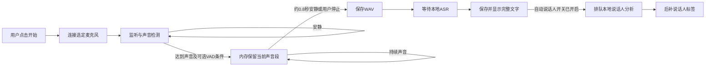

# 产品设计

本文件描述当前代码中的 Audio Agent，核对日期为 2026-10-24。功能状态以实际入口、存储行为和任务生命周期为准；路线图单独列出，不代表已经实现。安装见[安装与启动](installation.md)，日常操作见[用户指南](user-guide.md)，实现细节见[技术设计](technical-design.md)。

## 1. 产品定位

Audio Agent 是面向 Mac 的本地声音资料工作台：用户明确开始监听后，系统保留声音片段，在片段结束后完成本地转写；文字可在 Web、菜单栏和 MCP 中读取。用户也可以只缓存音频，稍后按需识别，或导入已有 WAV。

产品的核心产物是**完整、可复制、带录音时间的文字**。声音检测、语音识别、说话人分析和人物登记分别回答不同问题，界面不把它们包装成一个不可见的自动过程：

| 能力 | 解决的问题 | 产物 |
| --- | --- | --- |
| 声音活动检测 | 是否出现达到门槛的声音，何时结束 | 可变时长的声音片段 |
| 可选 VAD | 声音中是否存在语音活动 | 采集阶段的语音概率与筛选结果 |
| ASR | 说了什么 | 完整文字、时间段、语言等信息 |
| 说话人分析 | 这份录音中哪些时间段像是同一人 | 录音内匿名编号及发言区间 |
| 人物参考声纹 | 声音是否像用户明确登记的人 | 本人或具名人物标签、待核对的匹配标记 |
| MCP | 如何让另一工具读取或按需处理这些资料 | 本机 stdio 工具接口 |

“本地”指采集、识别、说话人分析和资料存储在本机完成。若 Claude Code 或 Codex 读取了转写，返回文字会进入该客户端的模型上下文，后续是否离线由客户端决定。产品不自动把录音上传到云端，也不自动下载模型。

## 2. 目标、用户与场景

### 2.1 当前目标

1. 用明确的开始/停止动作控制麦克风，未开始时不采音。
2. 安静时不新建录音和 ASR 任务，减少空转写与无用音频。
3. 以完整文档呈现当前保留期内的文字，刷新后能够恢复，复制时不漏掉未翻到的分页。
4. 用轻量菜单栏入口完成高频启停、查看、搜索和复制；复杂设置留在 Web。
5. 对已有 WAV 提供同一套导入、试听、转写和人物标注流程。
6. 让 MCP 读取已经生成的文字，避免为同一需求反复识别音频。
7. 让存储路径、保留时间、模型运行和人物登记具有可见的状态及失败原因。

### 2.2 主要用户场景

| 场景 | 用户动作 | 系统行为 | 完成标准 |
| --- | --- | --- | --- |
| 临时口述 | 在菜单栏或 Web 开始监听，说话后停顿 | 声音段结束后排队本地 ASR | 文字完整出现，可复制 |
| 双人讨论记录 | 开始监听，可选开启新录音自动区分说话人 | 原文先出现，人物标签随后补充 | 不因对方未登记而丢弃其话语 |
| 回顾刚才的表达 | 预先用 CLI 缓存，再请求最近窗口转写 | 只识别已落盘音频 | 返回所选时间范围，缺录部分有说明 |
| 整理外部录音 | 导入 WAV，手动发起转写或分析 | 创建受管理副本，保留源文件 | 可试听、查看完整文字及分析结果 |
| 将文字交给编程助手 | 客户端调用读取工具 | 返回已有文字与后补标签 | 不自动开麦，不重复运行 ASR |
| 调整本地资料位置 | 停止任务，填写空目标目录并确认复制切换 | 复制受管理资料、更新设置、切换当前服务 | 新目录可读写，旧副本保留 |

### 2.3 当前不承诺的能力

- 逐字流式显示；当前是声音段结束后再识别。
- 自动判断电视、旁人谈话与“正在和用户交谈的人”的关系。
- 仅保留本人、自动剔除其他人的声音，或从混合单声道中分离干净的人声。
- 跨录音稳定的匿名编号；`speaker_1` 每份录音重新定义。
- 自动生成摘要、待办、长期记忆或全文语义检索。
- DJI 内录文件的直接无线下载、跨 Mac 自动同步或云备份。
- 通用独立安装包、登录自启、系统全局快捷键已经自动设置。
- 12–24 小时连续运行、设备断连恢复和睡眠唤醒已经充分验收。

## 3. 功能状态矩阵

“已实现”说明有当前可用的代码路径，不等同于所有现场环境都已验证。性能、硬件和语音准确率的适用范围见[性能与资源](performance.md)及[模型说明](models.md)。

| 功能 | 当前状态 | 入口与边界 |
| --- | --- | --- |
| 显式开始/停止监听 | 已实现 | Web 与菜单栏；不接管其他 CLI 录音进程 |
| 声音触发、安静不落盘 | 已实现并有合成 PCM 回归 | Web/菜单栏会话；CLI 连续模式不同 |
| 停顿驱动动态分段 | 已实现 | 约 0.8 秒安静结束；无固定 5 秒/30 秒切片 |
| 本地 VAD | 已实现，需要本地模型 | Web 默认勾选；缺模型明确报错，可显式关闭 |
| 本地 Whisper ASR | 已实现，需要已有权重 | Web 会话自动转写、文件按需转写、CLI/MCP 按需调用 |
| 原文完整文档 | 已实现并有分页/完整性回归 | 按录音时间最新在前；当前保留期内全部记录 |
| Web 单段/全文复制与 TXT 下载 | 已实现 | 完整原文；全文带录音日期与起止时间 |
| 菜单栏搜索与复制 | 已实现 | 文字、录音名称、人物标签；复制保留人物信息 |
| WAV 导入与试听 | 已实现 | 本地规范化副本；Web 单文件上限 512 MiB |
| 同一录音重复转写 | 已实现 | 主文档只显示最新版本，记录页可查看历史版本 |
| 录音内说话人分析 | 已实现，需要本地模型 | 自动估计或指定 1–10 人；单文件不超过 600 秒 |
| 新监听片段自动分析 | 已实现、默认关闭 | 用户开启后，仅新 ASR 成功回调入队，不扫描历史 |
| 本人声纹与其他人物备注 | 已实现 | 本人最多 10 条参考，其他人物每人一条；试听确认，有效向量即可登记，无固定秒数门槛 |
| 跨录音人物匹配 | 已实现，有公开样本验证 | 仍需核对，现场误匹配率未系统标定 |
| 本机存储目录切换 | 已实现并有 HTTP/回滚回归 | 仅新/空目标，先复制后切换，不覆盖合并已有资料库 |
| MCP 独立设置页 | 已实现 | 展示配置及复制；不探测客户端是否真的接通 |
| MCP 增量读取 | 已实现并有协议回归 | 每客户端独立游标；主动拉取，不自动唤醒模型 |
| CLI 连续缓存、窗口转写、目录监听 | 已实现 | 默认 5 秒缓存片段；转写另行请求 |
| DJI RX / 内录导出全链路 | 部分研究、待硬件验收 | 可以导入已在本机的 WAV，不能据此声称无线链路完成 |
| 自动摘要/语义搜索/跨设备同步 | 未实现 | 不作为现有 UI 的隐含行为 |

## 4. 信息架构

### 4.1 Web 工作台

| 侧栏入口 | 页面内容 | 高频动作 |
| --- | --- | --- |
| 转写文档 | 监听开关、录音设置、自动说话人设置、完整正文 | 开始/停止、复制、下载、切换全部/本次 |
| 声纹与人物 | 本人参考列表、其他人物列表、参考录音选择与分析 | 试听、追加本人参考、整组替换、逐条移除、命名和备注 |
| 录音文件 | 展开资料库并切到录音列表 | 搜索、筛选、试听、导入、手动转写 |
| 转写记录 | 展开资料库并切到转写历史 | 搜索正文、查看版本、复制单条 |
| 存储位置 | 当前/默认路径、WAV/JSON 子目录、迁移表单 | 使用默认值、明确复制并切换 |
| MCP 接入 | 客户端配置、检查命令、工具说明、调用示例 | 复制配置或参数 |

“声纹与人物”“存储位置”“MCP 接入”是同一页面应用内的独立视图，不创建新浏览器标签。`/#storage` 和 `/#mcp` 支持直接定位；离开设置页恢复正文。录音和转写列表是主文档下方的工具区域，侧栏入口负责打开对应列表。

### 4.2 macOS 菜单栏

菜单栏是共享 Web 后端的轻客户端，不运行第二套采音和识别引擎。波形图标打开浮层，顶部始终放置监听开关，设备与收音门槛紧随其后，下方为搜索、完整文字和复制。底部提供“打开控制台”“存储位置”“退出菜单栏”。右键图标也可开始或停止。

应用没有 Dock 图标和独立主窗口。只有用户显式打开应用后，才会按需启动本项目的本地 Web 后端；此时不自动开麦。退出菜单栏保留后端，避免影响从 Web 控制的会话。

### 4.3 CLI 与 MCP

CLI 面向明确的采集、文件与脚本操作。MCP 面向调用方模型或代理，通过 stdio 暴露六个工具。工具说明、参数、游标约定分别见[API 参考](api-reference.md)、[MCP 接入](mcp-integration.md)和[MCP 使用](mcp-usage.md)。

## 5. 主要流程与状态设计

### 5.1 监听到文字

停止采音与完成已录片段是两件事。点击停止后先关闭麦克风并保存有效末段；已入队识别可继续完成。因此“待识别 N 段”不代表麦克风仍在录音。系统不会为了显示文字而强制每隔固定时长截断声音。

| 用户可见状态 | 含义 | 可做的事 |
| --- | --- | --- |
| 尚未开始/已停止 | 当前服务未采音 | 阅读、复制、设置、显式开始 |
| 正在启动 | 等待选定设备产生 PCM | 等待或停止；不显示虚假的录音成功 |
| 正在监听、等待声音 | 已收到输入，未确认有效声音段 | 继续说话或停止；不创建静音 WAV |
| 正在录制声音段 | 当前声音仍未结束 | 停顿后等待识别，也可明确停止 |
| 正在停止/处理已录片段 | 输入收尾或任务排队完成中 | 阅读已有文字，等待会话结束 |
| 错误 | 设备、模型、资源或任务失败 | 查看具体错误，核查后重新开始/重试 |

内部会话状态 `starting/recording/stopping/finished/error` 与声音子状态 `listening/recording` 分开。“会话 active”可能包含任务收尾，不应直接当作“麦克风开启”的指示。

### 5.2 声音筛选

声音门槛使用数字音频 RMS，Web 可调范围为 −60 至 −18 dBFS。更低更灵敏，更高更保守；它不是房间声压分贝、距离刻度或降噪强度。

当前默认具有短暂的声音确认与约 0.3 秒前置缓冲，结束时保留短尾音。长达约 600 秒的持续活动会触发资源保护：保留当前已收到的声音段并停止采集，而不是每 600 秒继续切出下一段。具体算法与参数见[技术设计](technical-design.md)。

VAD 可以减少部分非语音触发，但电视台词仍是语音。音量、VAD、说话人标签都不能判断社会关系或谈话意图。双人对话的设计目标是保留双方话语，不能默认以“仅本人声纹”过滤，否则会丢掉对方的发言。

### 5.3 文档与复制

正文从磁盘读取保留期内记录，跨分页形成同一快照后再提交，不依赖内存中的有限条“最近消息”。同一录音的多个转写只保留最新一份在主文档中，历史版本留在转写记录。

- 排序使用录音时间，最新在前；新结果不强制把用户滚动到顶部。
- 新增内容不打断用户正在选择的文字；需要替换所选正文时先保留旧快照，提示有更新。
- 分页失败、游标异常或中途数据变化时不开放部分全文复制。已有正文保留，并显示更新错误。
- 说话人分段必须能与权威原文完整对齐；不能对齐时保留全文并显示归属未对齐，不拼接出缺字的“新原文”。
- 相同名字不代表相同说话人 ID；不同 ID 的同名发言保留边界，重叠仍标为混合发言。
- 当前 Web 单段/全文复制保留原文，全文含时间；菜单栏复制包含人物标注。两者原文字不截断。

### 5.4 说话人分析与登记

手动分析由用户选择录音触发。自动分析设置默认关闭，用户开启后对后续新监听录音生效；当前正在进行的会话不必重启。开关关闭后停止新增自动任务，已排队任务可以完成。

ASR 先提供原文；说话人分析共享本地推理锁，结果到达后补标签。分析错误不删除原文，也不使声音采集因为缺少标签而失效。

登记流程为：选择录音 → 分析 → 试听确认人物 → 选择“我”或其他人物 → 明确确认保存。界面允许直接打开登记表单，不要求必须点击某个播放按钮才能解锁；提交仍要求用户勾选已试听并确认。登记绑定分析版本，重新分析后须再次确认。

有效声纹向量是登记条件，没有固定的 5 秒门槛；1–2 秒有时也能登记，清晰 10–20 秒参考通常更稳。后续自动匹配可能保留匿名、漏认或错认。显示“声纹匹配”表示模型比较结果，不是身份认证概率。名字“我”保留给本人参考，其他人物可填写名字和备注；更新参考须明确选择，不静默合并两个已有人物。

本人可保留最多 10 条参考，网页默认追加；明确选择替换才将整组换成当前一条。用户可单独移除样本，也可取消全部本人登记。建议从 3–5 段不同常见说话方式的清晰参考开始，但这不是最低数量或准确率保证。每条都要主动选择、试听和确认；系统不从最近讲话中偷偷补样、不自动学习或重新训练模型。旧单参考继续可读，首次主动修改登记才升级存储格式；不会因为原参考短就自动换掉它。

多参考只适用于本人。其他人物仍保留单条参考及明确替换流程。同一分析中的不同说话人不能同时登记为“我”，避免把两个人混入同一身份。

### 5.5 存储切换

存储页先展示真实路径，输入框与状态轮询独立，用户草稿不被轮询覆盖。“使用默认目录”只填值，不产生迁移。

显式点击复制切换后，后端检查任务与锁、校验新/空目标、复制 SQLite 与受管理资料、写入本机设置并替换当前服务的资料库。监听、转写、说话人分析等仍忙时拒绝切换。成功后旧目录保留为副本，并防止旧进程继续写入；失败则保持原运行库与配置可用。复制范围及回滚机制见[存储与隐私](storage-and-privacy.md)。

### 5.6 MCP 接入

接入页优先提供可整段交给目标 Agent 的 MCP + Skill 安装指令，支持当前项目与用户级范围，并保留底层配置文本供手动使用。浏览器只展示和复制，不写客户端文件。目标 Agent 执行安装器后，分别核验配置/Skill、stdio 协议和客户端实际加载；复制成功不等于连接成功。完整流程见 [Agent 一键接入](agent-setup.md)。

读取最新文字优先用 `audio_get_updates` 或 `audio_recent_transcripts`。首次增量默认仅取最近 20 条、最多 100 条，不补全部旧历史；完整文档导出使用 Web。增量读取由客户端保存游标，同一 `document_key` 更新时覆盖旧版本；服务不自动唤醒模型，不把所有客户端当作一个消费队列。只有明确请求 `audio_transcribe_*` 才执行按需本地识别。

## 6. 权限、隐私与失败边界

| 边界 | 当前约束 |
| --- | --- |
| 麦克风 | 只由显式开始动作启用；菜单栏在开始时请求 macOS 权限 |
| 模型 | 读取状态不加载模型；权重需事先准备，不自动下载 |
| 本机 HTTP | 仅回环绑定；验证 Host/Origin，写入使用当前服务令牌 |
| 音频读取 | 浏览器用库内片段 ID，不能指定任意磁盘路径 |
| 录音文字 | 作为不可信资料，不当作工具执行指令 |
| 参考声纹 | 向量本机私密保存，不发给网页/MCP；公开的是标签与必要状态 |
| 导入源文件 | 不修改；只对受管理副本进行规范化和保留期清理 |
| 数据保留 | 默认 24 小时；不是永久历史档案 |
| 外部客户端 | 读取文字后进入调用方上下文，本产品不能承诺该客户端全离线 |
| 客户端配置 | 页面复制配置，不自动修改外部客户端或全局信任 |
| 应用退出 | 退出菜单栏不关闭共享后端；停止监听必须显式操作 |

失败信息应描述可执行的下一步，例如选择正确设备、授权、等待当前任务、准备本地模型、选择空目录或刷新完整快照。禁止用“完成”掩盖超时、部分分页、旧状态或未确认的麦克风启动。

## 7. 产品验收标准

以下是当前功能应保持的验收条件；版本具体执行记录、测试命令与未完成验证由[开发与验证](development.md)统一维护。

| 领域 | 必须验证的行为 |
| --- | --- |
| 显式控制 | 打开任一页面、启动 MCP、复制配置不打开麦克风或运行识别 |
| 动态采集 | 长静音无 WAV/ASR；持续声音不按 5 秒切分；停顿输出一段；静音停止不生成空文件 |
| 生命周期 | 启动无 PCM 会失败；停止末段只保存一次；错误后不遗留隐藏采集 |
| 文档完整性 | 超过 200 条跨页读取；第二页失败不返回部分全文；重转去重；录音时间排序正确 |
| 人物 | 短参考有效即可登记；本人追加/整组替换/逐条移除边界清楚；分析版本变化拒绝旧确认；同名多 ID 不错误合并；移除标签不删除原文 |
| 自动分析 | 默认关闭；GET 不推理；只对新 ASR 成功片段排队；失败不阻断原文 |
| 迁移 | 无令牌拒绝；忙碌拒绝；非空目标拒绝；迁移后同 ID 可读；配置写失败完整回滚 |
| MCP | stdio 解析可靠；读取不触发模型；各客户端游标独立；重启游标明确失效 |
| UI | 正文不截断；长路径/名字安全显示；刷新不覆盖草稿；错误明确；窄屏可操作 |
| 本机资源 | 模型任务可超时/失败退出；ASR 与说话人分析不并发争用同一推理锁 |

公开音频样本与合成 PCM 可覆盖协议和生命周期，但不能代替真实中文、方言、远场、多人重叠、电视干扰和长时运行的准确率验证。性能指标必须注明设备、模型、时长、是否包含加载，不以模型文件大小冒充峰值内存。

## 8. 后续路线图

以下按价值与风险排序，是待评估工作，不是交付时间承诺。

| 优先级 | 方向 | 验收前提 |
| --- | --- | --- |
| P0 | 长时间运行、睡眠、设备拔插与恢复 | 有界实验、明确状态、无丢失或重复末段、不自动换麦 |
| P0 | 日常中文与背景人声评估 | 分开测漏收、误收、ASR 错字、说话人误匹配及资源成本 |
| P0 | 跨 Mac 安装与可维护发布 | 新机可复现依赖、模型路径、签名权限及数据恢复流程 |
| P1 | 短句推理加载开销优化 | 证明收益，同时保持释放资源、超时隔离与本地默认 |
| P1 | 更明确的导出与归档体验 | 保留原文、时间、人物标签，清楚区别缓存与长期档案 |
| P1 | 多输入设备与 DJI RX 验证 | 先确认本机音频输入，再测试断连与实际拾音差异 |
| P2 | 摘要、语义检索、上下文整理 | 用户显式授权，明确本地/外部模型边界，源文字可追溯 |
| P2 | DJI 内录无线导出或跨设备同步 | 独立验证协议和传输机制，不把本地文件导入当作完成 |

技术拆分见[技术设计](technical-design.md)，接口契约见[API 参考](api-reference.md)，常见失败处理见[故障排查](troubleshooting.md)。
