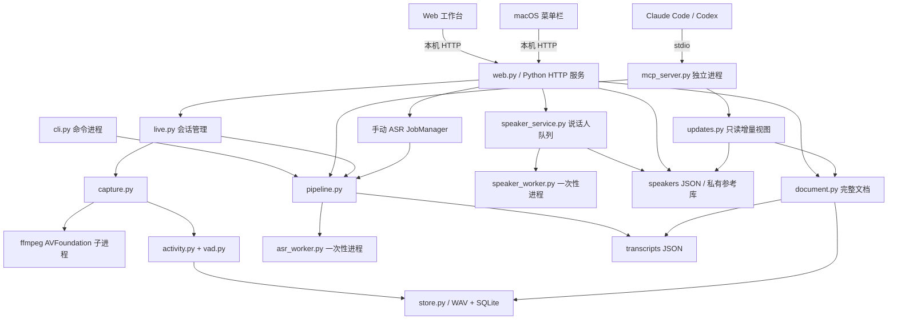
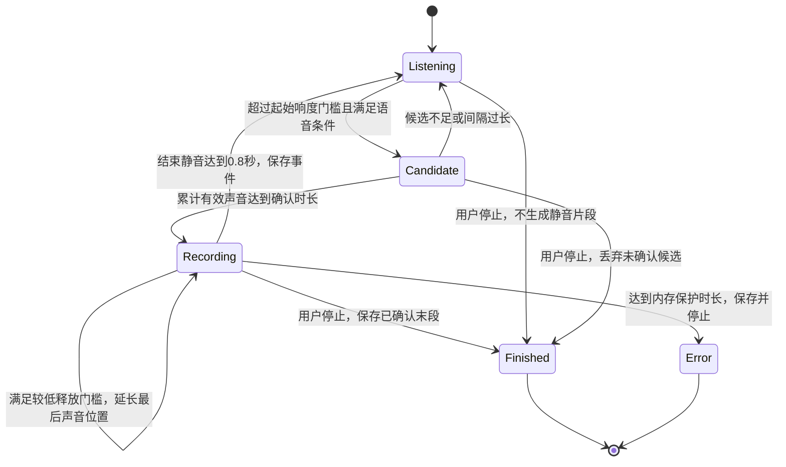
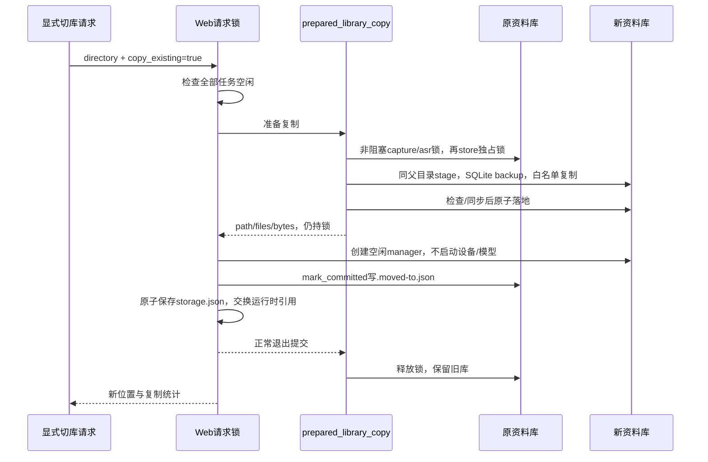

# 技术设计

更新日期：2026-10-24。本文描述当前仓库源码：Python 包版本 `0.1.0`；菜单栏构建脚本声明版本 `0.1.4`、构建号 `5`。这不证明某台机器正在运行的 `.app` 或 Python 服务已更新；部署后需要独立核对。

本文面向实现与维护人员。产品边界见[产品设计](product-design.md)，操作流程见[使用指南](user-guide.md)，模型配置见[本地模型](models.md)，具体请求见[API 参考](api-reference.md)。

## 1. 实现范围

Audio Agent 是单机音频资料库与本地处理服务。目前有四类入口：Web 工作台、macOS 菜单栏、CLI、stdio MCP。它们共享规范化 WAV、SQLite 元数据和 JSON 转写，但各自的进程、任务内存和连接生命周期独立。

- 只有显式开始动作可打开麦克风。读取页面、状态、文档、MCP 信息不会开始采集或模型推理。
- Web/菜单栏的“开始监听并自动转写”授权当前会话的动态采集与 ASR；CLI `record`/`start` 只做连续缓存。
- 录音先形成完整声音事件，再转写；不是逐词或逐 token 流式识别。
- 自动说话人分析为独立、持久化、默认关闭的开关；文字先可用，标签稍后补上。
- 运行时不下载权重，不调用云端 ASR，不修改 Handy 的配置、历史或模型。安装依赖与手动准备模型是另一项操作。
- macOS 采集使用 ffmpeg AVFoundation。现有构建脚本面向 Apple Silicon、macOS 13+，不是跨平台独立安装包。

## 2. 进程与模块



| 模块 | 责任与边界 |
| --- | --- |
| `capture.py` | 明确设备、独占采集锁、ffmpeg 生命周期、PCM 消费、计量和状态文件；不直接运行 ASR。 |
| `activity.py` / `vad.py` | 在写 WAV 前识别声音事件；可用本地 Silero v4 语音概率，保持逐流状态。 |
| `store.py` | 规范化存储、导入去重、时间切片、快照、磁盘余量与保留清理。 |
| `pipeline.py` / `asr.py` | 对已提交音频做稳定快照，持推理锁完成识别并原子保存文本。 |
| `live.py` | 一次显式会话的采集监视、顺序 ASR、停止后的末段处理；只收集本会话来源。 |
| `speaker_service.py` / `speakers.py` | 独立顺序分析队列、私有参考登记、公共标签；失败不撤销已完成文本。 |
| `document.py` / `updates.py` | 全量文档快照与增量更新；不打开音频文件、不运行模型。 |
| `storage_config.py` / `storage_migration.py` | 只读位置解析、显式配置写入、复制迁移、旧库写入保护。 |
| `web.py` / `web_assets` | 本机请求校验、API、静态页面、完整文档与任务交互。 |
| `macos/AudioAgentBar` | 原生菜单栏、权限请求、完整分页读取、显式开始/停止和门槛控制。 |
| `watcher.py` | 监视已挂载/已同步目录中的稳定 WAV；不实现 DJI 私有同步协议。 |

CLI Web 默认端口是 **8765**；菜单栏构建配置使用 **8767**。菜单栏可连接已有合法服务，必要时启动独立 Python 服务。退出菜单栏不会停止共享后端或替用户停止录音。源码中的存储配置与 MCP 页面变化不会自动替换已经构建的原生程序。

## 3. 音频数据流

### 3.1 动态采集

1. 用户选定设备并显式开始；不使用“默认麦克风”静默替代选定设备。
2. `AudioCapture` 获取本资料库的 `.capture.lock`，检查磁盘余量；启用 VAD 时先初始化模型并用静音验证一次推理。
3. ffmpeg 把指定设备转换为 **16 kHz、单声道、PCM16 小端**原始字节流。
4. `ActivityGate` 接收任意字节边界，保留有界预录音环形缓冲，确认活动后才积累一个事件。
5. 声音结束或显式停止时提交 WAV；静音和未确认短点击不生成空文件。
6. `LiveManager` 按 `source=live:<session_id>` 和 SQLite `rowid` 收集新提交片段，顺序调用 ASR。
7. 文本提交成功后，若当前自动说话人开关开启，再提交说话人分析。后补标签不会重写原始转写文本。

时间戳由首批 PCM 到达时间估计，再按样本偏移计算。空白间隔保留在事件的绝对时间轴上；不把多个声音事件压成连续时间。硬件输入延迟未经测量，因此不是采集卡级精确同步时间。

### 3.2 连续缓存与导入

CLI `record`/`start` 保持 `activity_triggered=False`，默认每 5 秒提交一次，包括静音；这是显式连续缓存模式。Web/菜单栏不会使用这个周期作为事件切片规则。

导入会先把源 WAV 复制成 `incoming/` 中的稳定快照，比较源文件身份、大小与修改时间，再对快照计算原始 SHA-256。需要转换时只转换快照，源文件不改。规范化后的文件经校验、哈希和数据库提交进入 `clips/`。原文件内容哈希用于去重，规范化文件哈希用于记录实际保存内容。

`FolderWatcher` 默认等大小与修改时间稳定 3 秒，轮询间隔默认 2 秒。默认跳过 `Edit` 目录和 `_edit.wav`；不接受与资料库互相包含的监视目录。启动或重启 watcher 不会自动运行 ASR。

## 4. 动态分段与状态机



默认参数来自 `CaptureConfig` 和 `ActivityGate`：

| 参数 | 默认值 | 含义 |
| --- | --- | --- |
| 起始 RMS | `0.006`，约 `-44.437 dBFS` | 声音事件的起始响度门槛；用户可设置 `-60` 到 `-18 dBFS`。 |
| 释放 RMS | 起始值的 `2/3` | 允许同一句话中的较弱声音继续保持事件。 |
| 确认声音 | `0.2 s` | 抑制单个短点击；不等同于说话人识别。 |
| 预录音 | `0.3 s` | 确认后回带起始前的一小段音频，减少切掉字头。 |
| 结束静音 | `0.8 s` | 达到后提交事件，保存约 `0.2 s` 尾部而非完整静音。 |
| 内存保护 | `600 s` | 达到后保存当前整段并停止采集；不会重复定时分片。 |
| VAD 开始/保持概率 | `0.5 / 0.35` | 使用概率滞回，和响度门槛一起判断。 |

RMS 模式以 320 个样本（20 ms）处理；Silero v4 使用 512 个样本（32 ms）原生帧。开启 VAD 后，候选累计允许短弱音间隙：候选间隙约 96 ms、总候选窗口受限；并不要求每个 20 ms 帧都超过较高起始门槛。所有 PCM（包括静音）进入同一流的 VAD，以保持循环状态；最后不足一帧仅在推理时补零，保存的音频不增加补零样本。

VAD 检测“像不像语音”，不识别用户本人，也不能保证排除电视、远处同事讲话或音乐中的人声。后续声纹标签只注释已录片段，不是前置本人过滤。缺少权重、运行库或模型接口不匹配会明确报错，绝不把 RMS 模式伪装成已运行 VAD。

门槛设置先原子保存，再通知采集对象。正在一个声音事件中时设置保持 pending，到回到 `listening` 才应用，不切断当前发言。`audio_level` 表示真实 PCM 电平；`audio_peak_level` 是近期窗口内最大 20 ms RMS，均不是 VAD 概率。

会话 `state` 与活动 `activity_state` 是两个层次：`recording` 表示已收到采样、麦克风会话运行，不代表当前正在落盘一段讲话；`activity_state=listening` 表示等待活动。`stopping` 期间麦克风可以已停止，但 ASR 尚在处理末段，`active` 仍可能为真。初始化 `starting` 不能显示成“已听见声音”；10 秒未收到 PCM 会停止并提示权限或设备问题。

## 5. 调度、锁与停止顺序

| 机制 | 作用域 | 保证 |
| --- | --- | --- |
| `.capture.lock`，非阻塞独占 | 同一资料库、跨进程 | 不同时打开两个该库采集器；未持有锁的 Web 对象不能停止 CLI 的采集。 |
| `.asr.lock`，非阻塞独占 | 同一资料库、跨进程 | CLI、MCP、实时 ASR、手动 ASR、说话人分析共享模型任务互斥；包含结果持久化阶段。 |
| `.store.lock`，共享/独占 | 同一资料库、跨进程 | 文件读取快照、数据库提交、清理、设置/参考写入和迁移互斥；独占锁获得后检查旧库 fence。 |
| manager 自身锁/条件变量 | 单进程 | 保护队列、状态、正在执行动作和关闭标志。 |
| Web `_request_lock` | 同一 HTTP 服务 | 请求与切库不交错，不在一份响应中混合两个库。 |

单次手动 Web ASR 只允许一个 queued/running 任务，忙碌返回 409，内存保留最多 100 个任务。预检查模型锁不构成预约；若另一个进程之后抢先持锁，任务仍可能异步失败，客户端必须轮询任务最终状态。

实时 ASR 队列默认容量 12，只处理当前会话，不扫描历史会话补转写。它会复用已成功保存的同 clip 转写，遇到外部模型忙碌有限重试。已知本服务说话人任务持锁时，额外片段暂留 SQLite，由 row cursor 后续收集；`pending_count` 包含 deferred 数量，不能报告为零。一般积压超过容量会停止麦克风；ASR 硬错误也停止会话，已保存 WAV 保留以便手动重试。

说话人任务串行执行，queued/running 总数默认不超过 12，完成历史保留最近 50 个；等待 ASR 优先或模型锁默认最多 120 秒。自动开关可在会话中改变，只影响以后新完成 ASR 的片段，不补历史。关闭自动开关不取消已入队任务。自动去重/任务状态存在进程内，重启不恢复队列。

ASR 和说话人原生推理运行在一次性子进程中。ASR 默认超时 300 秒，可配置 1–1800 秒；说话人默认 300 秒，可配置 1–600 秒。原生崩溃或超时只使该任务失败，不应杀死 HTTP/MCP 服务。VAD 在采集进程内运行。权重与 GPU 缓冲在每次 ASR 子进程退出后释放，代价是重复加载模型。

关闭服务的顺序是：停止本服务采集并提交末段 → 等待实时 ASR → 等待显式手动 ASR → 关闭说话人队列。说话人关闭取消尚未运行的排队任务，已开始的推理完成后收尾。受模型超时约束，关闭不保证立即返回。

## 6. 持久化格式

资料库默认是项目 `.data/`，可显式迁移到其他位置。位置解析顺序为 CLI `--data-dir`、环境变量 `AUDIO_AGENT_DATA_DIR`、本机 `storage.json`、项目 `.data`。模型位置独立于资料库位置，不跟随录音迁移。

```text
<data-dir>/
  audio.sqlite3                 # WAL 模式索引；WAL/SHM 是运行时文件
  clips/<clip-id>.wav            # 16 kHz / mono / PCM16
  exports/<export-id>.wav        # 受管理的快照/时间窗口导出
  transcripts/<transcript-id>.json
  speakers/<clip-id>.json        # 私有分析，包含局部说话人向量
  voiceprint.json               # 本人多参考 v2；兼容旧版单参考读取
  speaker-profiles.json         # 人物名字/备注及私有参考
  live-settings.json            # trigger_db
  speaker-settings.json         # automatic_enabled
  incoming/                     # 临时上传/导入；未提交内容
  work/                         # ASR 快照；通常随请求结束删除
  capture.json                  # 采集进程状态
  .capture.lock / .asr.lock / .store.lock
  .moved-to.json                # 仅迁移后的旧库存在
```

规范化录音与 JSON 文件采用私有文件权限，新建目录为 `0700`、文件为 `0600`。默认写入检查保留 256 MiB 磁盘余量；这不是磁盘配额，仍需处理实际写入失败。这些权限也不是磁盘加密或用户间身份认证；备份、系统管理员和同用户进程仍属于本机信任边界。

SQLite 的 `clips` 字段：

| 字段 | 类型/含义 |
| --- | --- |
| `id` | UUID hex 主键；应用生成 32 位小写十六进制。 |
| `path` | 受管理的相对路径 `clips/<id>.wav`，唯一。 |
| `start_time`, `end_time`, `duration` | Unix 秒与时长；时间轴按原录音而非转写完成时间。 |
| `frames`, `sample_rate`, `channels` | 样本数及统一格式。 |
| `source` | 例如 `live:<session_id>`、`avfoundation:<device>`、`web-import`、`folder-import`。 |
| `sha256` | 已保存规范化 WAV 的哈希。 |
| `import_sha256` | 可空；原始输入内容哈希，唯一，用于导入去重。 |
| `created_time`, `size_bytes`, `original_name` | 入库时间、文件字节数、可空原始文件名。 |

另有 `exports(id, path, created_time)` 表。连接短生命周期，WAL 与 `busy_timeout=15000` 用于并发访问。数据库事务不能单独保证 WAV 生命周期，所以文件快照与清理同时受 store 文件锁保护。

转写 JSON 保留 `id`、`created_at`、`text`、完整 `segments`，以及 backend、language、时长和耗时等结果字段。按 clip 转写还保存 `clip_id`、`source`、原录音起止、原文件名和显示名；按时间窗口转写保存 `audio` 的输出偏移与原时间映射。`segments.start/end` 是片段内相对秒数。转写文件不保存临时 WAV 路径。

说话人 sidecar 的 `id` 是分析版本，`turns` 记录 `{start,end,speaker}`，`speakers` 包含局部 ID、参考秒数和私有向量。参考库绑定 `clip_id + analysis_id + speaker_id + embedding_model_id`。HTTP 的公共对象仅取字段白名单，绝不输出 embedding。

本人 `voiceprint.json` 的 v2 格式为 `{version:2,created_at,updated_at,samples:[...]}`，最多 10 个私有参考。每条保留独立 ID、时间、分析绑定和向量；旧单参考文件只读兼容，不在 GET 时重写，首次实际修改登记才写 v2。`append` 保留旧样本，同一绑定重复追加幂等；`replace` 把整组替换成当前一条。HTTP 缺省模式为 `replace` 以兼容旧调用，新网页显式发 `append`。禁止在同一分析中把不同 speaker 都登记为本人，其他人物仍是单参考模型。

单样本删除按稳定 `sample_id` 定位；非法或不存在的 ID 报错。移除最后一个样本及取消全部登记直接删除本人参考文件，不留下空的 v2 集合；录音、原文与其他人物参考不被删除。

公开本人状态给出样本数、总参考秒数和每条样本的来源 metadata，不输出向量。`model_compatible` 当前为 null：状态读取不加载或计算模型权重哈希；是否可参与某次匹配取决于该分析的 embedding 模型 ID。

## 7. 文档、标签与增量读取

完整文档按 clip 选择当前快照中最新有效转写，重复转写不会形成重复正文；没有 clip 的时间窗口导出转写各自保留。后端按 `(start_time, id)` 升序返回，Web 可以在完整快照收齐后反转成“最新在上”；不能逐页反转后拼接。

`document_page` 首次生成时间 cutoff，游标绑定资料库、limit、source、snapshot 和最后排序键，并带进程内密钥签名。分页期间新转写不插入旧快照；清理或修改旧文件仍可能让 total/revision 变化。客户端需校验整批 metadata、重复 ID/游标和完整数量，变化时重取，不能把半页文档当成“复制全部”。重启后旧游标失效。

原录音被清理而转写仍在保留期内时，文档保留文本和录音时间，标记 `recording_available=false`。说话人注释仍依赖有效录音及分析，音频过期后不承诺保留动态身份标签。

说话人标签在读时投影：匿名号码只在一个录音内有效；手动确认来源优先，自动匹配必须使用相同 embedding 模型、有效向量、候选参考至少 2 秒、余弦相似度至少 0.65，并在人物竞争与同录音说话人竞争两侧满足 0.1 差距。当前分析中手动占用的身份不再分给另一位说话人。任一已存在参考库损坏时关闭自动身份匹配，仍可保留有效库的明确人工绑定。

本人身份的比较分数按当前 analysis 的 `embedding_model_id` 筛选样本后计算：`sum(cosine(candidate, sample_i) * min(reference_seconds_i, 10)) / sum(min(reference_seconds_i, 10))`。各次 cosine 使用单位方向比较；不对平均结果再归一化，也不取 max-of-N。这样多条不一致的参考不会仅因归一化或“多次抽中最高分”而获得更高分。样本增加可能降低分数，不构成准确率单调提升承诺。其他人物仍使用单参考；本人仍作为一个身份参加人物竞争，而不是把每个样本当成一个人物。任何有效样本与当前分析的精确绑定可提供人工来源，且该身份不能再自动分给同片另一 speaker。

登记参考本身没有固定最低秒数；有效向量和正参考时长仍是必要条件。分析版本过期、未显式确认或人物冲突会被拒绝。名字/备注改变或移除立即影响读时标签，不重新推理，不改转写文件。自动匹配标签带“声纹匹配”提示；相似度不是身份概率。

每个 ASR segment 可与多位说话人的时间段重叠，因此输出 `speaker_ids[]` 和 `speaker_labels[]`，不能假设一个文本段只对应一个人。Web revision 组合正文 metadata 与 sidecar/参考文件的 mtime、大小指纹；它是变化检测标识，不是文件内容完整性证明。

增量 feed 使用独立、进程内签名的 sequence 游标。稳定键是 `clip:<id>` 或 `transcript:<id>`；后补标签、人物备注、重转写都可产生同一键的新版本。首次只取最近少量并建立基线，不补全部历史；后续按页最后水位推进，未读的中间修改可合并成最新版。不发送删除 tombstone，因此它是 upsert 视图，不是完整镜像或审计日志。每个客户端保存自己的游标，调用不会“消费掉”其他客户端的数据。协议用法见 [MCP 使用](mcp-usage.md)。

## 8. 保留与清理

- 默认保留 24 小时；采集录音按 `end_time`，导入录音按 `created_time` 计算，旧历史录音导入后仍有完整保留窗口。
- 转写按 JSON 文件 mtime 独立保留；音频与文字可能在不同时间过期。
- 采集提交后和 watcher 循环会清理录音；保存新转写时会清理旧转写；CLI `prune` 显式清理两者。单纯打开页面不会发起清理。
- Web 读取逻辑过滤已过期录音与文字，即使磁盘尚未执行物理删除也不继续展示为可用音频。CLI 的低层片段列表可能仍列出等待物理清理的行。
- 清理 clip 同时清理其 speaker sidecar；显式登记的 `voiceprint.json` 和 `speaker-profiles.json` 不随源 clip 过期删除。
- 导出跨片段窗口会去掉缺口，并返回 gap/offset 映射；不会伪造静音填补时间轴。时间重叠时先前片段优先，可用 source 约束避免混合来源。

### 接入安装

MCP + Skill 的安装与数据迁移分开：Web `agent-setup.js` 用只读配置元数据生成完整安装指令，浏览器只复制文本。目标 Agent 执行 `scripts/install-agent-integration`，由 `agent_install.py` 合并 JSON/TOML 的本服务项、安装独立技能包；TOML 使用 `tomlkit` 保留注释。安装前检查同名服务/技能，备份置于技能发现目录外，文件写入采用暂存替换与可捕获异常回退。安装器不调用 MCP、开麦或运行模型；独立 `check-mcp-connection` 仅执行协议握手和 `audio_status`。配置落地、协议可用与客户端加载分别报告，详见 [Agent 一键接入](agent-setup.md)。

## 9. 迁移事务与旧库保护

Web 切库是同步复制与应用，旧库保留。只有采集、实时/手动 ASR、说话人队列都空闲，且没有环境变量固定覆盖时才允许开始。



目标必须为新目录或空目录，普通自定义目标的父目录需存在；拒绝符号链接组件、路径跳转、与源相同或互为父子目录。复制前检查目标空间，保持磁盘余量。SQLite 使用 backup API，不能直接复制打开的 DB/WAL；目标最终自包含。

白名单包括数据库引用的 `clips/`、`exports/` WAV，UUID 命名的转写和 speaker JSON，以及四个设置/参考文件。模型、测试夹具、缓存、日志、上传中的文件、旧状态与锁内容不复制；新目标仅创建全新空锁。复制保留文件 mtime，避免延长文字保留期。

`mark_committed()` 在保存配置前原子写旧库 fence；之后发生可捕获异常时撤回该标记和迁移自己创建的未改变文件。回滚不会通配删除用户后来新增、替换或编辑的文件。旧对象获取 store 独占锁后再次检查 fence；ASR 锁和空间检查也拒绝已迁移库。导入在规范化期间被迁移的情况会在最终提交被拒绝，原 WAV 保持不变。

现存 MCP、CLI、watcher 不会自动换库，必须重连/重启；已开始但未提交的旧写入必须失败，不能悄悄写成两份库。Python 异常路径有回滚测试，但多个文件和运行时指针不是断电级分布式事务：若进程被强杀在 fence 与配置提交之间，需要核对两份资料和配置后恢复，不承诺自动恢复。详见[存储与隐私](storage-and-privacy.md)。

## 10. 请求安全与故障边界

HTTP 仅绑定 loopback，同时校验来访 IP、单一 Host、实际端口和可选 Origin；不启用 CORS。非 GET/HEAD 请求要求当前服务 token。token 只防跨站误用，不是用户认证系统。允许没有 Origin 的本机原生/CLI 请求，但仍执行 Host、IP 和写 token 校验。

静态文件只从资源目录白名单读取；音频只通过有效 clip ID 打开。音频 fd 在 store 读锁内获取，之后即使清理 unlink，当前播放仍有稳定 fd。JSON 请求上限、上传上限、明确 Content-Length、禁止 Transfer-Encoding、有限 socket timeout 限制输入规模；错误不回传 Python traceback。安全头和同源策略详情见 [API 参考](api-reference.md)。

当前服务按全请求 RLock 串行处理路由，播放输出、上传和同步迁移可能延迟其他请求；不是高并发远程媒体服务器。文档/增量快照仍扫描 JSON，较大库的反复分页有额外成本；不是无限历史搜索引擎。

## 11. 后续方向（尚未完成）

| 方向 | 当前边界 / 验收目标 |
| --- | --- |
| 独立安装和签名分发 | `.app` 依赖构建时项目绝对位置、`.venv` 和外部模型；需可迁移运行时、签名/公证与升级策略。 |
| 文档索引与共享快照 | 降低多客户端轮询扫描成本，保留完整正文、稳定分页和标签变化检测。 |
| 迁移崩溃恢复 | 增加恢复日志与启动诊断，覆盖强杀/断电，不破坏当前异常回滚约束。 |
| 房间噪声与本人优先 | 需要专门数据集和误录/漏录评估；提高 RMS 或启用 VAD 不等于近场身份选择。 |
| 长录音与任务恢复 | 当前内存任务队列不跨重启恢复，超长讲话由保护停止；需明确恢复/分段产品规则。 |
| 识别质量评测 | 用获许可、可复现的测试集评估 CER/WER/DER；成功 smoke 不代表真实场景准确率。 |

相关实现与测试入口见[开发指南](development.md)，实测限制见[性能](performance.md)，常见问题见[故障排查](troubleshooting.md)。
